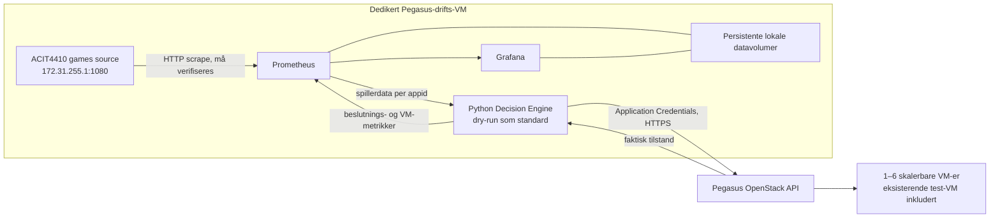

# Migreringsplan: Pegasus som hele kjøremiljøet

Oppdatert etter godkjent opprettelse samme dag: drifts-VM-en er nå ACTIVE.
Pegasus API-endepunkter er tilgjengelige fra gjesten, men spilldatakilden feiler
og SSH fra arbeidsmaskinen får tidsavbrudd. Ingen full utrulling er startet.
Se [drifts-VM-rapporten](pegasus-management-preflight.md). Resten nedenfor
bevarer undersøkelsen og planen som lå til grunn for godkjenningen.

Status 2026-10-20: lesende gjennomførbarhetsundersøkelse. **Ingen ny VM,
sikkerhetsregel, nettverksrute eller Pegasus-tjeneste er opprettet/endret.**
Ingen Moria-ressurs er endret. Planen erstatter forslaget om lokal Windows-drift
med Moria-tunnel. Den innebærer ikke godkjenning til å utføre migreringen.

## Anbefalt arkitektur

Drifts-VM-en er permanent under demonstrasjonen og ligger **utenfor**
skaleringspoolen. Den skal ikke ha poolens navnemønster/eierskapsmetadata,
og kan derfor aldri stoppes av autoskaleren. Moria inngår ikke i dataflyten,
autentiseringen, SSH-transporten eller et nødvendig runtime-steg.

Anbefalt drifts-VM: `ruby-acorn-management-01`, Ubuntu 24.04,
`aem.2c4r.50g` (2 vCPU, 4 GiB RAM, 50 GiB disk). Dette er et startestimat for
Prometheus, Grafana og Python uten ML; faktisk minne-/diskbruk må observeres.
Ingen TimesFM-runtime eller ekstra infrastrukturtest-VM planlegges.

Skaleringspool: `aem.1c2r.50g`, Ubuntu 24.04, samme eksisterende ACIT4410-nett,
inntil seks VM-er totalt på tvers av spill. Gjenbruk test-VM
`1517a4dc-ad07-45da-8fd2-c87307a9f8fb` / `192.168.44.33`, med poolnavn `vm-test`.
Ikke ommerk, flytt, slett eller bygg den om for å få den inn i poolen.

## Hva som er undersøkt og hva som ennå ikke er bevist

Med OsloMet VPN frakoblet fikk lokal Pegasus-autentisering tidsavbrudd.
Etter at brukeren koblet til VPN igjen fungerte autentisering og Compute-,
Network- og Cinder-lesing. Web-innlogging brukes ikke som bevis for API-tilgang.
Vi skal ikke endre Windows-ruter, VPN, Tailscale eller Pegasus-nett for å omgå
denne forskjellen. At tjenestene kjører i Pegasus skal fjerne Windows/Moria-
kombinasjonen som runtime-avhengighet; gjestens forbindelser må likevel testes.

API-et viser eksisterende delte nett:

| Nettverk | Type | Subnett / gateway |
| --- | --- | --- |
| ACIT4410 | shared, internal, ACTIVE | 192.168.44.0/22, gateway 192.168.44.1 |
| oslomet | shared, external, ACTIVE | 10.196.240.0/20 og campus-IPv6 |

ACIT4410-subnettet har DHCP og DNS, men annonserer ingen eksplisitte host routes.
Prosjektet har ingen egne rutere. En felles gateway kan fortsatt rute til andre
nett; tom `host_routes` eller fravær av prosjekteide rutere beviser ikke at
spilldatakilden er utilgjengelig. Like nettverksnavn i Moria/Pegasus beviser
heller ikke at samme datakilde er tilgjengelig.

Eksisterende VM-konsoll ble lest uten å endre VM-en. Den viser ferdig cloud-init
og gateway 192.168.44.1. Det finnes ingen datakildeprobe i konsollen. En ren
TCP-test fra arbeidsmaskinen til VM-ens port 22 fikk tidsavbrudd; ingen innlogging
eller security group-endring ble forsøkt.

**Tilgjengelighet fra en Pegasus-gjest til spilldatakilden er derfor ikke
verifisert.** Det finnes nå ingen autorisert gjestesesjon der en HTTP-test kan
kjøres. Det samme gjelder gjestens tilgang til alle katalogførte OpenStack-
endepunkter; fungerende API fra Windows er ikke tilstrekkelig bevis.

Første godkjente opprettelse må være den faktiske drifts-VM-en. I dens
bootstrap kjøres ikke-muterenede forbindelsestester og ufarlige resultater
skrives til konsollen:

1. `http://172.31.255.1:1080/health`: forvent HTTP 200 og lesende replay-status.
2. `/metrics`: forvent gyldig Prometheus-format og spillerdata med appid 730/570.
3. `https://pegasus.sky.oslomet.no:5000/v3/`: bekreft TLS og Identity-discovery.
4. Etter sikker lokal credential-konfigurasjon i gjesten: autentisering,
   prosjektkontroll og GET/list mot Compute, Image og Network fra samme miljø
   som skal kjøre beslutningsmotoren. Ikke logg tokens eller rå SDK-feil.

Denne proben er en del av drifts-VM-ens klargjøring, ikke en ny separat test-VM.
Ved feil stoppes migreringen før flere VM-er opprettes. Be kurs-/Pegasus-
administrator om støttet datakildeadresse eller eksisterende ruting for dette
nettverket. Ikke fall tilbake til syntetiske data, Steam eller Moria-tunnel og
presenter det som ACIT4410-integrasjon.

## Kvoter og foreløpig antall VM-er

Direkte autentisert API-lesing 2026-10-20 ga:

| Ressurs | Kvote | Brukt nå |
| --- | ---: | ---: |
| Nova-instanser | 10 | 1 |
| vCPU | 12 | 1 |
| RAM | 24576 MiB (24 GiB) | 2048 MiB |
| Nettverksporter | 10 | 1 |
| Floating IP-er | 5 | 0 |
| Nye prosjekteide nettverk / subnett / rutere | 0 / 0 / 0 | 0 / 0 / 0 |
| Security groups / regler | 10 / 100 | 1 / 4 |
| Cinder-volumer | 10 | 0 |
| Cinder-disk | 300 GiB | 0 |
| Cinder-snapshots | 0 | 0 |

Anbefalt ramme, betinget av gjestens nettverksprøve og uendrede kvoter:

| Oppsett | VM-er | vCPU | RAM GiB | VM-rotdisk GiB | Porter med én NIC per VM |
| --- | ---: | ---: | ---: | ---: | ---: |
| Første migreringssteg: drift + eksisterende test-VM | 2 | 3 | 6 | 100 | 2 |
| Full demo: drift + seks skalerbare VM-er | 7 | 8 | 16 | 350 | 7 |
| Ledig ved full demo | 3 VM-plasser | 4 | 8 | Ikke separat oppgitt Nova-diskkvote | 3 |

Eksisterende test-VM er inkludert, ikke lagt til som en åttende VM. Seks er
maksimum for **skaleringspoolen**, mens drifts-VM kommer i tillegg.
Hvis seks skal gjelde absolutt hele prosjektets demo, bruk drift + fem
skalerbare VM-er: 6 VM-er, 7 vCPU, 14 GiB RAM, 300 GiB rotdisk og 6 porter.

Disk må ikke feilregnes: dagens controller bruker image-boot med flavorbasert
rotdisk, og test-VM-en har **ingen** Cinder-volume. Cinder viser fortsatt 0 GiB
brukt etter opprettelsen. 350 GiB VM-rotdisk betyr derfor ikke automatisk
350/300 GiB Cinder-bruk. Fysisk ledig Nova/hypervisor-disk er ikke verifiserbar
fra den tilgjengelige prosjektkvoten, så plass til syv oppstarter er ingen
garanti. Hvis alle syv VM-er i stedet bootes fra 50 GiB Cinder-volumer, kreves
350 GiB og planen **overskrider** 300 GiB-kvoten. Det er ikke det foreslåtte
oppsettet. Ingen nye blokkvolumer er nødvendig for første prototype.

Bruk eksisterende nett. Ingen router-/nettverksopprettelse er mulig innenfor
gjeldende nullkvoter. Ikke anta at floating IP kan tilknyttes bare fordi kvoten
er 5: dette krever en støttet nettverks-/routersti. Hvis en ekstra NIC på det
eksisterende `oslomet`-nettet skulle bli nødvendig og godkjent, ville full demo
bruke 8 porter; dette er en reserveplan, ikke en endring som er utført/anbefalt
før gjestens faktiske forbindelser er undersøkt.

## Konkret implementeringsrekkefølge etter separate godkjenninger

1. **Klargjør én drifts-VM og utfør nettverksporten først.** Bruk anbefalt
   2 vCPU / 4 GiB / 50 GiB og eksisterende nett. Foreta prober under bootstrap;
   ikke ta med secrets i cloud-init eller konsoll. Eksisterende test-VM og
   sikkerhetsregler beholdes. Ved kildefeil: avklar offisiell Pegasus-rute med
   faglærer/admin før utrulling fortsetter.
2. **Avklar beskyttet administrasjon.** Velg en faktisk tilgjengelig VPN-/campus-
   rute til gjesten. Eventuell ny administrasjonsgruppe og kun SSH fra en
   eksplisitt godkjent kilde-IP/CIDR må godkjennes før opprettelse. Ikke åpne
   9090, 8001 eller 3000 for internett. Grafana kan brukes gjennom en senere
   godkjent SSH-portforward til loopback. Ingen nye Tailscale-/VPN-ruter inngår.
3. **Egen Pegasus Compose-konfigurasjon.** Behold dagens lokale/Moria-oppsett.
   Lag `docker-compose.pegasus.yml` for bare Prometheus, Grafana og Python-
   autoscaler. Prometheus scraper spillkilden direkte fra gjesten og motoren på
   `autoscaler:8001`; Grafana bruker `http://prometheus:9090`. Ingen Steam-
   eksportør, Windows `host.docker.internal`, Moria-prefikser eller tunnel er
   nødvendige i målkonfigurasjonen. Skill kurskilden med metric-/source-label.
4. **Gjenbruk Dockerfile og installer SDK ekstraet.** Nåværende image installerer
   bare basisavhengigheter. Lag en liten SDK-buildvariant med `.[openstack]`,
   uten ML. Monter spill-/poolkonfigurasjon lesende og separate vedvarende
   datavolumer for TSDB, Grafana og controllerens tilstand/journal/lås. Sett
   eksplisitt `--metrics-host 0.0.0.0` inne i Compose-nettet. Eksisterende image
   har allerede en ikke-root-bruker; volum-/secret-rettigheter må tilpasses den.
5. **Sikker autentisering i gjesten.** Behold application credentials utenfor
   repo, Git, containerimage, `.env` og cloud-init. Krev godkjent sikker
   overføring/lokal innlegging i drifts-VM før den utføres; dagens lokale fil
   skal ikke automatisk kopieres. Monter kun til autoscaler som lesende fil
   og sett `OS_CLIENT_CONFIG_FILE`. Test prosjekt-ID og API-lesing fra selve
   containeren. Behold TLS-verifisering.
6. **Algoritmer og eksisterende VM.** Gjenbruk registry, strategier, klient,
   engine, kostmodell og backend. Poolen `vm-test` inkluderer test-VM-en
   uten ommerking. Bruk separate appid-eiere, en samlet seks-VM-grense og
   én manager. Drifts-VM er uttrykkelig ekskludert. Behold 100 spillere/VM som
   demonstrasjonsmodell, eksplisitt spillerandel/headroom, rate-limit og
   Pegasus-pause. Ikke implementer sletting. Multispill-/felleslås-endringene
   som allerede ligger i arbeidskopien må ferdigtestes før de brukes.
7. **Dry-run ende til ende på Pegasus.** Provisjoner eksisterende dashboards og
   de tre nye kursvisningene. Verifiser kilde, scrape-ferskhet, appid-labels,
   ønsket antall, faktisk API-antall, riktig strategi og kostmodell gjennom
   Grafana API/panelspørringer og visuell kontroll. Feil/manglende spillerdata
   skal gi utilgjengelig input, aldri null spillere eller oppfunne VM-er.
8. **Separat godkjenning av automatisk drift.** Først da aktiveres Pegasus-
   mutasjoner. Demonstrer at faktisk variasjon i kursstrømmen fører til
   opp-/nedskalering og at det samme vises i Prometheus/Grafana. Ikke gjenta
   isolerte infrastrukturtester. Logg UUID, årsak, før/etter og latens. Start
   eventuelt med lavere poolgrense for demonstrasjonen; øk til seks først etter
   kontroll av samlet kvote og observerte behov.

Prometheus/Grafana-data i den gamle installasjonen kan bli stående som historikk.
Flytt konfigurasjon/dashboards først; ikke kopier live TSDB-/SQLite-filer ukritisk.
Ingen sletting eller stopp av gamle tjenester inngår i denne migreringsplanen.

## Status mot de fem minimumskravene

Grunnlag: lest prosjektbeskrivelse i `Downloads/Project_description.md` og
brukerens bekreftede krav. Følgende gjelder målmiljøet i Pegasus, ikke bare
kode eller resultater fra tidligere lokal-/Moria-drift:

| Krav | Implementert / eksisterer | Verifisert tidligere | Gjenstår i Pegasus |
| --- | --- | --- | --- |
| ACIT4410-kilde i Prometheus/Grafana | Prometheus/Grafana finnes; kildeformat er kjent | Kurskilden er historisk replay; tidligere kilde-/Prometheus-lesing utenfor Pegasus | Gjesteprobe, direkte scrape, ferskhet og paneldata |
| Minst tre dashboards | Eksisterende dashboards + tre nye kurs-JSON-er | Tidligere lokale dashboards; nye kurs-JSON-er er arbeidskopi | Provisjonering og alle panelspørringer/visuell QA i Pegasus |
| Motor skalerer ekte VM etter spillerantall | Engine + SDK-backend; per-game integrasjon under arbeid | Én ekte VM opprettet/stoppet/startet på eksplisitte testmål 1/0/1 | Sammenhengende spillerstyrt skalering etter aktiveringsgodkjenning |
| Motorens effekt visualiseres | Beslutnings-/VM-/event-/kostmetrikker finnes | Lokal/Moria-observabilitet fra tidligere; direkte Pegasus VM-API-test | Scrape av ekte Pegasus-motor og Grafana-verifikasjon på drifts-VM |
| Minst to algoritmer, valg per spill | reactive_capacity, threshold, aggressive og TOML; Pegasus-multispill under arbeid | Eldre enhetstester av strategier/per-game framework | Full regresjon av nye endringer og demonstrert valg med kursdata |

Alle fem krav kan støttes av denne arkitekturen, **betinget av datakilde- og
API-tilgang fra gjesten**. Ingen av de fem skal rapporteres ferdig demonstrert
ende til ende på Pegasus ennå. De tidligere 340 testene beviser tidligere
kodeversjon; senere multispill-/dashboardutkast er ikke ferdig kvalifisert.

Foreslåtte målvisninger som gjenbruker eksisterende provisioning:

- Game Monitoring — `ruby-acorn-course-games`.
- Autoscaling Monitoring — `ruby-acorn-course-scaling`.
- Cost & Strategy Comparison — `ruby-acorn-course-costs`.

Historisk replay må merkes. Kostnader er demo-estimater (ikke Pegasus-faktura),
og sammenligning av alternative strategier på samme input må merkes hypotetisk
dersom strategiene ikke har styrt virkelig kapasitet over et målt tidsrom.

## Arbeidskopi og avgrensning

Tidligere ucommittede endringer er bevart. Moria-tunnelutkastet
`scripts/start_course_source_tunnel.ps1`, Windows-launcher og de nye lokale
Prometheus-scrapeutkastene er **ikke målarkitekturen** og skal ikke tas i bruk
for denne migreringen. Ingen nye tjenester ble rullet ut som del av denne
lesende undersøkelsen. Gjeldende Compose kjører fortsatt lokalt; det er ikke
en Pegasus-installasjon. Ingen push eller merge er utført.

Bevis uten credentials: ignorert `data/pegasus/migration-feasibility-readonly.json`.
Ingen rå konsoll-/tokenutdata er lagret der.

Offisielt grunnlag: [Nova-kvoter](https://docs.openstack.org/nova/latest/user/quotas.html),
[SDK-konfigurasjon](https://docs.openstack.org/openstacksdk/latest/user/config/configuration.html)
og [Compose secret-mounts](https://docs.docker.com/compose/how-tos/use-secrets/).
